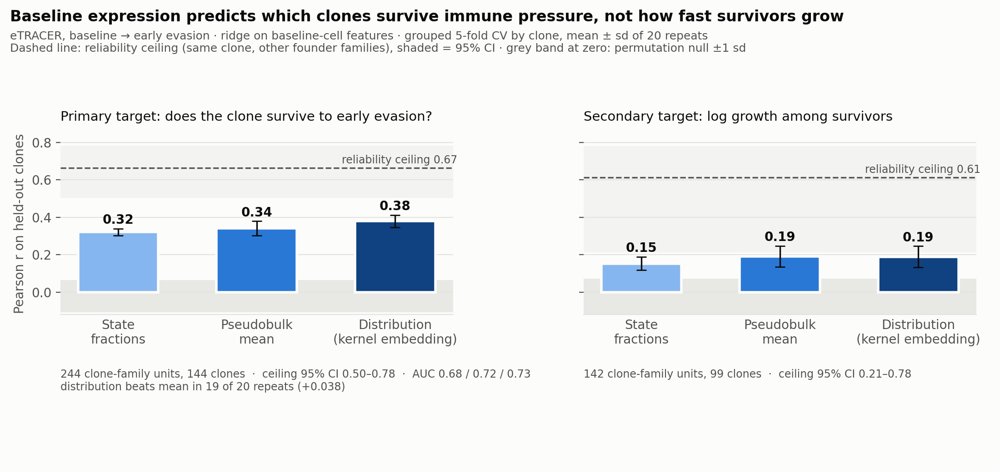

# Clone-conditioned flow matching on eTRACER

Scaffold for the conditioning-ladder experiment. Related-work and positioning
live in the project doc; this repo is the running code.

## Layout

    Tumor_Immune_Evasion_eTRACER/   the deposit, as downloaded (2.5 GB)
    notebooks/                      nb00 -> nb02, run in order
    src/etracer.py                  shared loaders, growth table, ridge + grouped CV
    scripts/                        rds -> h5ad conversion and its verification
    derived/                        outputs; nb00 writes the manifest everything else reads

## Getting the data

The deposit is not in this repo. Download `Tumor_Immune_Evasion_eTRACER.zip`
from Zenodo record [19230230](https://zenodo.org/records/19230230) (posted
2026-03-26) and unzip it here. Then build `derived/etracer_counts.h5ad` with
the commands under "The count matrix". The small result tables in
`derived/*.csv` are committed; everything else in `derived/` is regenerated.

An older record, [16406856](https://zenodo.org/records/16406856) (2025,
`eTRACER.zip`), has the same cells and clones but a more permissive clone
table: 91% of EE cells called vs 47% here. See
`docs/rung1_reconciliation.md` before mixing numbers computed on the two.

## Running

    cd notebooks && jupyter lab

`nb00` -> `nb01` -> `nb02`. Each writes to `derived/`, and the later ones read
what the earlier ones wrote.

## The count matrix

`derived/etracer_counts.h5ad` — 91,411 cells x 32,285 genes, 399,161,403
nonzeros (13.5% dense), raw integer UMI as float32 CSR, 967 MB gzipped.
Converted locally, no R involved.

### Why not readRDS

`sc_UMI_count.rds` is a Seurat v5 object that expands to 5.02 GB. The Cowork VM
has 4 GB of RAM and no R, so `readRDS` cannot load it at all, and installing R
would not have helped. `scripts/rds_to_h5ad.py` instead walks R's
serialization format directly and streams the two large sparse arrays straight
into HDF5, so peak memory stays at ~216 MB.

    python3 scripts/rds_to_h5ad.py scan \
        Tumor_Immune_Evasion_eTRACER/scRNA/sc_UMI_count.rds derived/rds_manifest.json
    python3 scripts/rds_extract.py \
        Tumor_Immune_Evasion_eTRACER/scRNA/sc_UMI_count.rds \
        derived/rds_manifest.json derived/etracer_counts.h5ad
    python3 scripts/verify_h5ad.py derived/etracer_counts.h5ad \
        Tumor_Immune_Evasion_eTRACER/scRNA/scRNA.metadata.csv

Two passes: the scan maps where things are, the extract streams only the
targeted vectors. Takes about 60 s each. Needs `h5py`; `anndata` only for the
verification step. `scripts/convert_seurat_to_h5ad.R` is kept as the
conventional route for a machine that does have R and the memory.

A dgCMatrix is CSC over (genes x cells), which is byte-for-byte the CSR of
(cells x genes). The transpose is therefore free and no reindexing happens.

### Verified against the deposit

Per-cell UMI totals recomputed from the matrix match `nCount_RNA` on
**0 / 91,411** mismatches, and per-cell detected genes match `nFeature_RNA` on
**0 / 91,411**. Cell names come out identical to the metadata and in the same
order, max UMI is 4,126, and no entry is non-integer — so float32 is lossless
here. Total 1,899,181,893 UMI.

### The join key, which is easy to get wrong

The metadata has two cell identifiers and they are not interchangeable:

| Column | Example | Use |
| --- | --- | --- |
| `cell_id` (the CSV's unnamed index) | `T1_T1_a3026_AAACCCAAGACTAGAT-1` | matches `h5ad.obs_names` |
| `cell` (the CSV's `cellName`) | `T1_a3026_AAACCCAAGACTAGAT` | metadata-internal only |

`et.load_metadata` returns both. Join anything from the h5ad on `cell_id`.

## Protocol, fixed before any model

- Group by clone. Notebook 00 proves components == clones for this deposit
  (no static barcode is shared between clones; no cell maps to two clones), so
  the clone id is a valid group key.
- Report mean +/- sd over 20 repeats of grouped 5-fold CV, with a permutation
  null. Single splits swing 0.26 to 0.51 on this data.
- State the minimum-cells-per-clone threshold beside every number, and report
  extinction both as an observed zero and as censored.
- On a family hold-out, report the rung-0 clone-identity lookup alongside
  every expression arm.

## Results so far

- `docs/ladder_results.md`: the conditioning ladder on the reformulated
  targets. Baseline expression predicts clone survival (kernel embedding
  r = 0.38, AUC 0.73, against a ceiling of 0.67). It barely predicts growth
  among survivors (r ≈ 0.19).

- `docs/rung1_reconciliation.md`: why rung 1 scored 0.323 in one session and
  0.263 in another. Both are right for their target. The predictable signal is
  clone survival (r = 0.330), not growth among survivors (r = 0.145).

## Facts measured from the deposit

91,411 cells, 32,285 genes. 15 tumours: 3 BL (one per founder family a3026 /
a3028 / a3030), 6 EE (two passages per family), 6 LE. 173 clones, 109 present
at all three stages, 132 present in all three families.

Clone-call rate is roughly flat at 47% / 47% / 57% for BL / EE / LE. An earlier
note recorded 49% / 91% / 95%; the deposited metadata does not support that, and
`nb00` is the cell that settles it.
