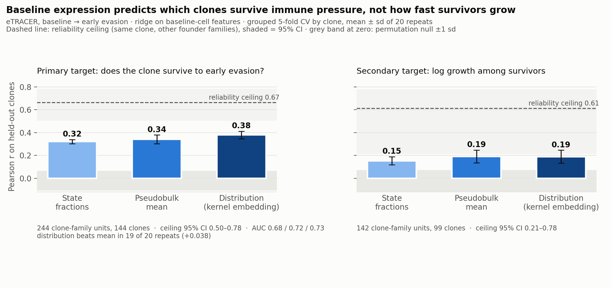

# Conditioning ladder, re-scored on the reformulated targets (2026-11-01)

**Inputs.** All features come from baseline cells only:
- the five annotated state fractions;
- the pseudobulk mean of per-cell log-CPM over a 400-gene panel;
- a random-Fourier kernel mean embedding of the clone's cell distribution
  (512 features, median-heuristic bandwidth).

The panel is fate-blind: genes with ≥ 2,000 pooled UMI, ranked by variance
across the 15 tumour pseudobulks.

**Protocol.**
- Ridge regression, penalty chosen by inner grouped CV.
- Grouped 5-fold CV by clone, 20 repeats, so no clone is in train and test.
- A permutation null for every cell of the table.
- Units: clone-family pairs with ≥ 20 baseline cells.
- Code: `scripts/score_ladder.py`, then `scripts/plot_ladder.py`.

## Results (`derived/ladder_scores.csv`)

| Target | State fractions | Pseudobulk mean | Kernel mean embedding | Null | Ceiling (95% CI) |
| --- | --- | --- | --- | --- | --- |
| **Survival to EE** (primary, n = 244) | 0.321 ± 0.019 | 0.341 ± 0.038 | **0.379 ± 0.032** | ≈ −0.02 | 0.665 (0.505–0.784) |
| AUC for survival | 0.683 | 0.725 | 0.728 | | |
| Growth among survivors (n = 142) | 0.153 ± 0.035 | 0.191 ± 0.056 | 0.189 ± 0.056 | ≈ −0.02 | 0.614 (0.214–0.781) |
| Growth, extinction at 0.5 cells (old mixed target) | 0.260 ± 0.024 | 0.388 ± 0.049 | 0.363 ± 0.065 | ≈ −0.01 | 0.756 (0.637–0.832) |

The ceiling is √ICC of the target across founder families for the same clone,
i.e. how well the target reproduces itself.

## Distribution vs mean (`derived/ladder_paired.csv`)

Paired by CV repeat:

| Target | Embedding − mean | Repeats the embedding wins |
| --- | --- | --- |
| Survival | +0.038 ± 0.046 | 19 of 20 |
| Growth among survivors | −0.002 | 11 of 20 |
| Old mixed target | −0.025 | 5 of 20 |

## Reading

- **Expression predicts survival.** The kernel embedding reaches r = 0.38 /
  AUC 0.73, about 57% of the survival ceiling.
- **It barely predicts growth among survivors** (r ≈ 0.19). That target's
  ceiling is too uncertain (CI 0.21–0.78) to say whether more is achievable.
- **The distribution-over-mean advantage holds only for survival.** It is
  absent for growth among survivors and reversed on the old mixed target. The
  Oct 30 headline ("distribution beats mean, 19/20, p < 0.0001") was on a
  different target and clone table (see `rung1_reconciliation.md`). It should
  be restated as a survival result.

## Caveats

- The 20 repeats re-split the same 244 units, so they are not independent.
  Read paired win counts and Wilcoxon p-values as stability checks, not
  significance tests.
- The panel uses tumour pseudobulks from all stages. It is blind to clone
  fate, but not to stage.
- `derived/headroom.csv` (from `nb01`) still mixes Oct 30 and Oct 31 numbers
  and is superseded by this table.
